<div align="center">


# Verso

**The other side of every story.**

Verso reads 33 news outlets from left to right, groups their coverage into events, and puts every side of a story on one page: who covered it, how each outlet worded it, and which facts every side reports.

[](https://vercel.com/new/clone?repository-url=https%3A%2F%2Fgithub.com%2FHamzaviour%2FVerso-AI&env=DATABASE_URL,GROQ_API_KEY,CRON_SECRET&envDescription=Neon%20connection%20string%2C%20free%20Groq%20key%20and%20a%20random%20cron%20secret&project-name=verso)
&nbsp;


</div>

---

## Contents

- [Demo video](#demo-video)
- [Why Verso](#why-verso)
- [Features](#features)
- [Screenshots](#screenshots)
- [How it works](#how-it-works)
- [Architecture](#architecture)
- [Tech stack](#tech-stack)
- [Project structure](#project-structure)
- [Getting started](#getting-started)
- [Environment variables](#environment-variables)
- [Deploying to Vercel](#deploying-to-vercel)
- [Scripts](#scripts)
- [Data model](#data-model)
- [Design system](#design-system)
- [Testing and quality](#testing-and-quality)
- [Honesty and limits](#honesty-and-limits)
- [Roadmap](#roadmap)
- [Credits](#credits)

---

## Demo video

<div align="center">

[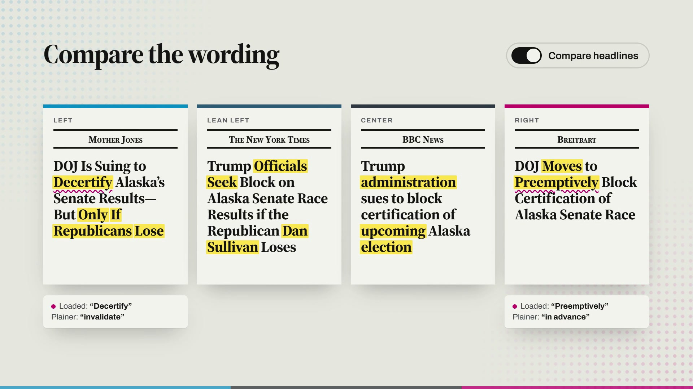](docs/media/verso-demo.mp4)

**[▶ Watch the product video (52 s, 1080p, narrated)](docs/media/verso-demo.mp4)**

</div>

The video walks through the product on a real story from the live wall: today's wall, the spectrum, headline comparison, agreed facts, the headline game and the bubble meter. It was built in HTML with Hyperframes. The source is in [`brag-output/composition/`](brag-output/composition/).

---

## Why Verso

The same event reads very differently depending on who prints it. Most readers see one or two outlets and never see the rest of the coverage. Aggregators show you more links, but they don't show you **how the coverage differs**.

Verso answers four questions for every story:

1. **Who covered it, and who didn't?** Every outlet is plotted by political lean and factual reliability.
2. **How did each outlet frame it?** Headlines sit side by side, with the words only a few outlets chose highlighted.
3. **What do all sides agree on?** Claims are attributed to the outlets that report them. Code, not the model, decides whether a claim is agreed, one-sided or contested.
4. **How balanced is my own reading?** A private bubble meter tracks the spread of what you open, stored only in your browser.

---

## Features

| | Feature | What it does |
|---|---|---|
| 🗞️ | **Today's wall** | Every card is one news event, with a coverage strip showing which part of the spectrum covered it. |
| 📍 | **Spectrum plot** | Outlets slide onto a two-axis chart: lean from left to right, reliability from bottom to top. Built with D3 scales and a force layout that avoids collisions. |
| ✍️ | **Neutral summary with citations** | An LLM writes a neutral headline and summary. Every sentence carries chips for the outlets it draws on. |
| ⚖️ | **Agreed facts vs one-sided claims** | Claims are grouped into *Agreed*, *Only on the left*, *Only on the right*, *Contested* and *Narrowly reported*. The grouping is computed from where the supporting outlets sit (`src/lib/claims.ts`). |
| 🖍️ | **Headline comparison** | Each outlet's headline is shown as a front page. The compare toggle highlights words few other outlets used. |
| 〰️ | **Loaded-language detector** | Framing words are underlined and listed next to a plainer alternative. |
| 🎯 | **Headline guessing game** | The landing page asks you to place a real headline on the spectrum, then reveals which outlet ran it. |
| 🫧 | **Bubble meter** | Scores how evenly your reading spreads across the spectrum, using entropy. Stored in `localStorage` only and never sent anywhere. |
| 🌗 | **Light and dark themes** | Editorial newsprint palette in both modes, with no flash on load. |
| 📱 | **Responsive** | Designed for phones as well as desktop. |
| 🧪 | **Sample edition** | With no database configured, the site shows a clearly labelled edition built from a fictional event. |

---

## Screenshots

### Landing page with the headline game
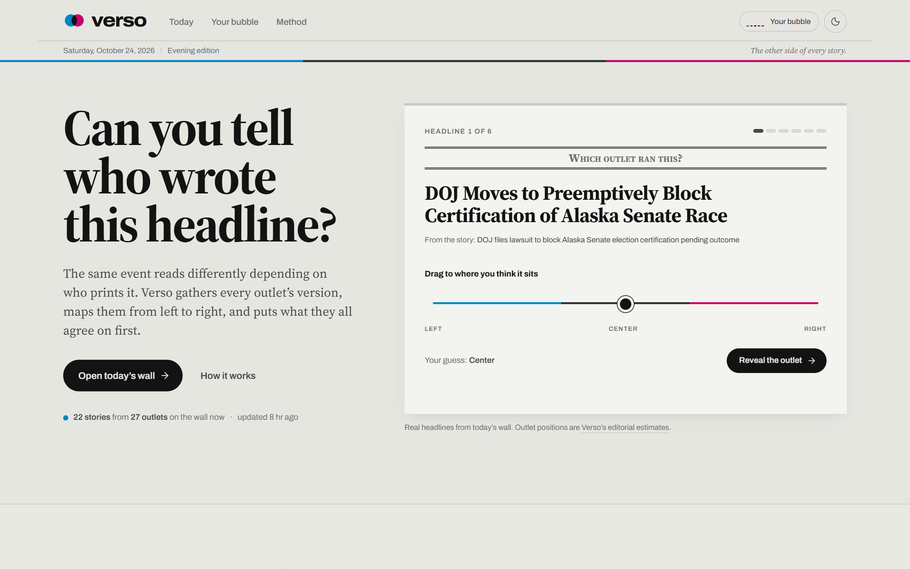

<details>
<summary><b>Dark mode</b></summary>

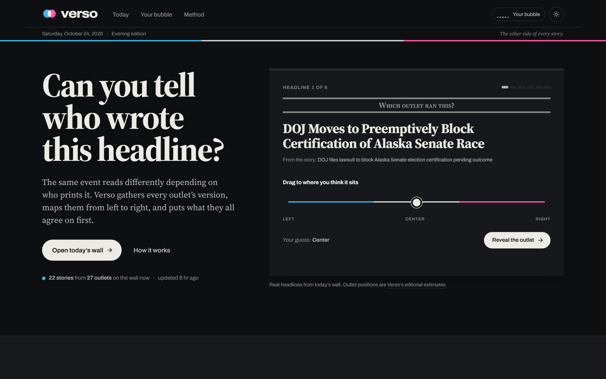

</details>

### Today's wall
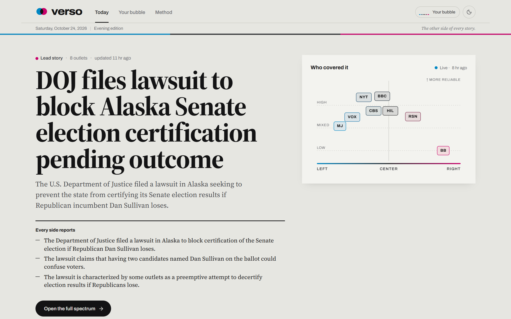

### Story page: neutral summary and the spectrum
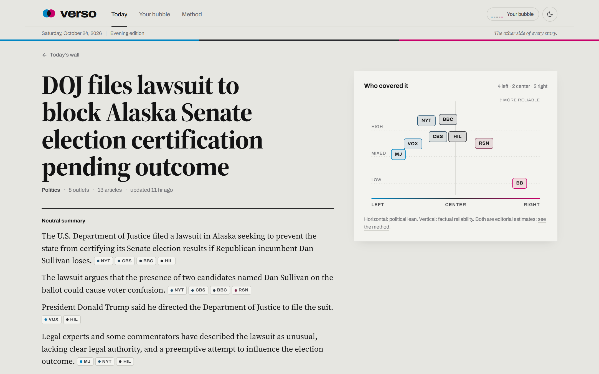

### Headlines side by side
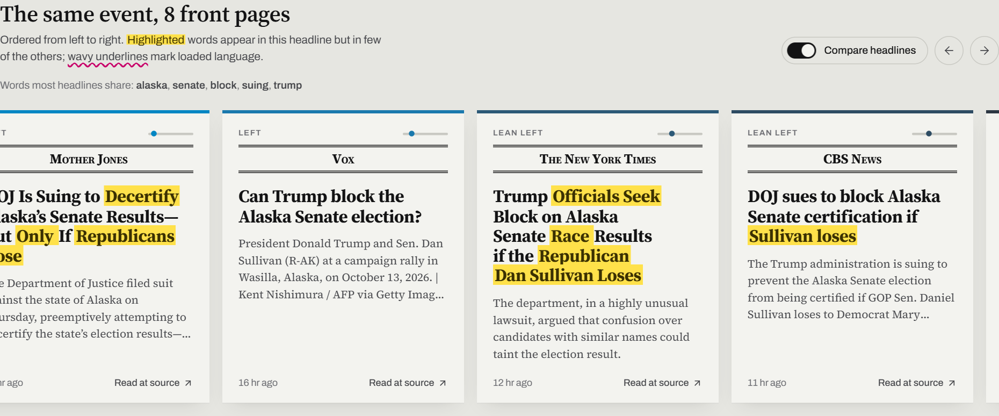

### Agreed facts and one-sided claims
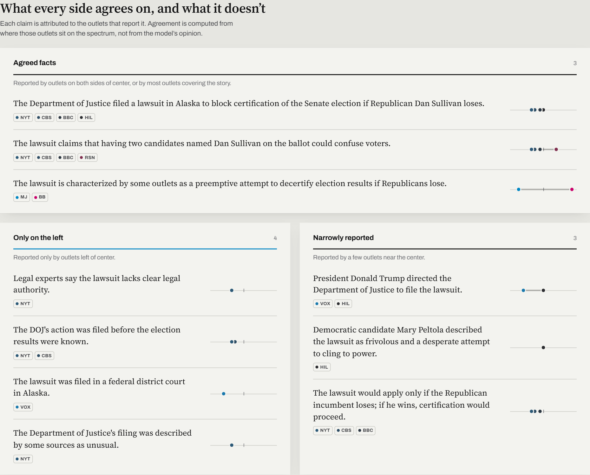

### Loaded language
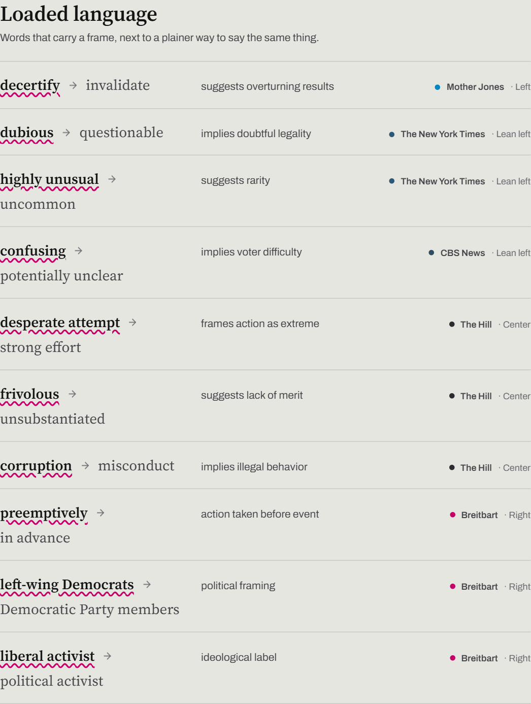

<details>
<summary><b>More: bubble meter, method, brand board, mobile</b></summary>

#### Your bubble
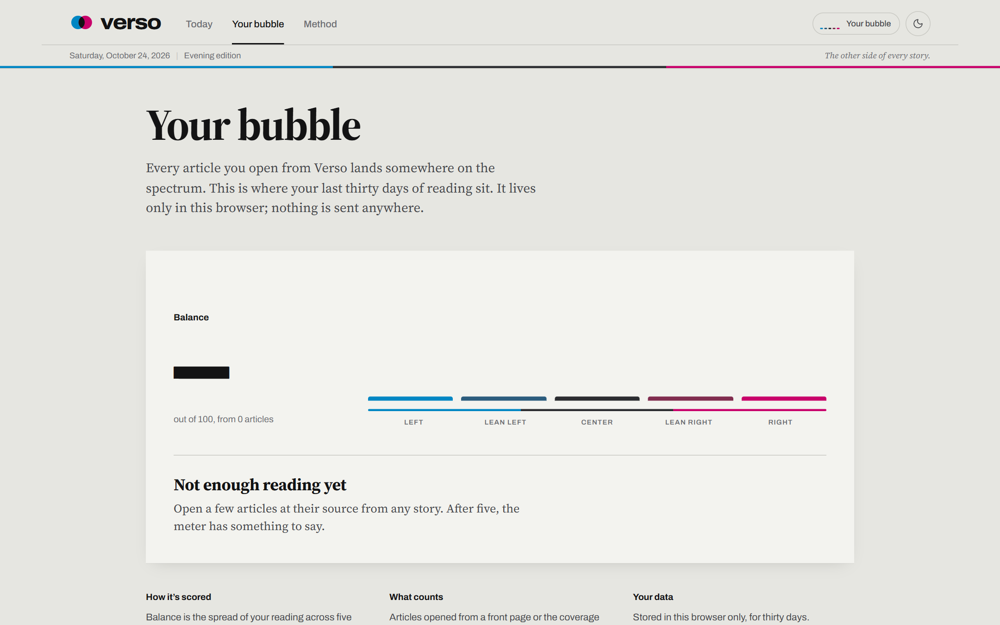

#### Method and outlet ratings
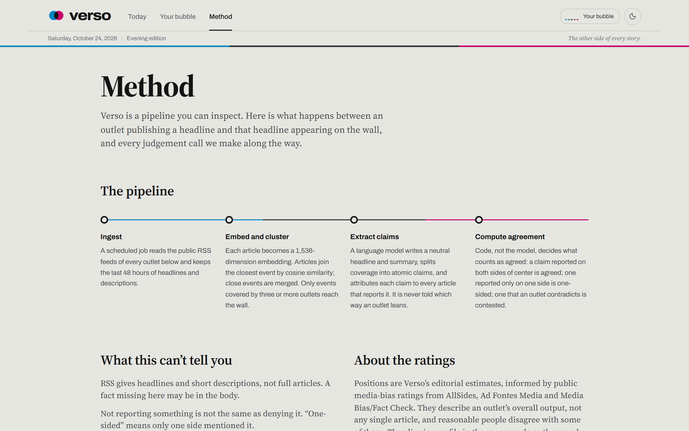

#### Brand board
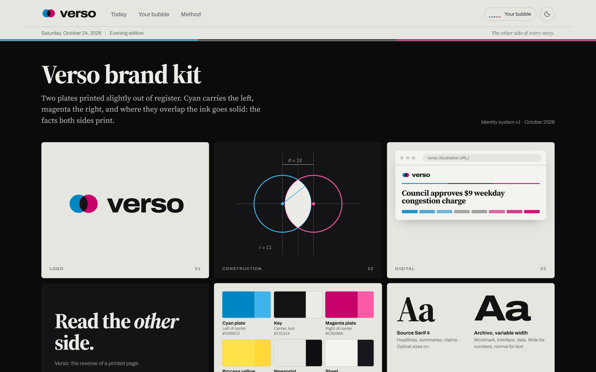

#### Mobile
<p>
  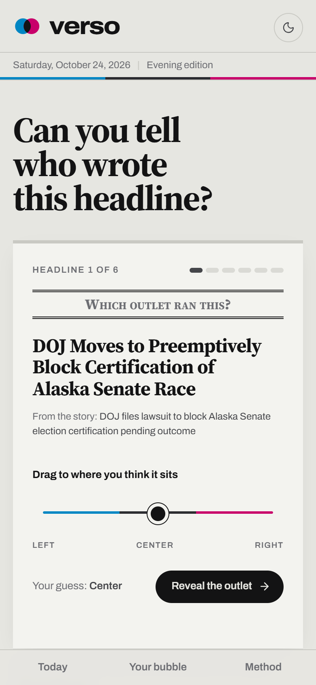
  &nbsp;&nbsp;
  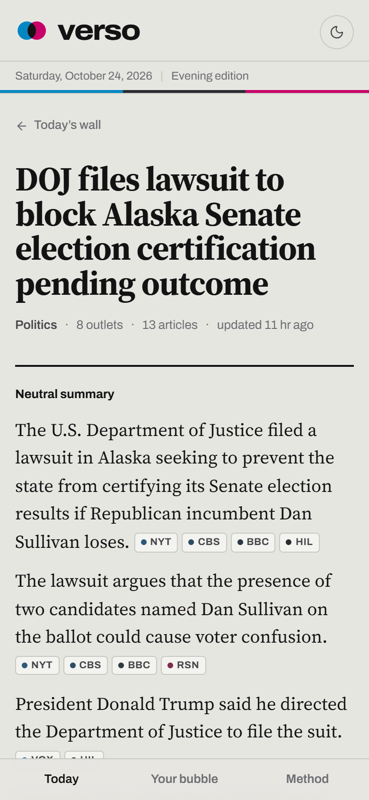
</p>

</details>

---

## How it works

Every run of the pipeline goes through four stages:

1. **Fetch.** RSS feeds from 33 outlets are fetched in parallel (`rss-parser`). Only items from the last 48 hours are kept, and they are bulk-inserted with `unnest()` while duplicate URLs are skipped.
2. **Embed.** Each headline and description is embedded **locally** with `all-MiniLM-L6-v2` (384 dimensions, q8 quantized) through transformers.js. No API key and no cost.
3. **Cluster.** Articles are grouped into events in two passes: first a leader-centroid pass (join at cosine ≥ 0.63), then a union-find merge of centroids (≥ 0.72). Event IDs stay stable between runs through a majority vote. The thresholds come from a measured similarity distribution of real headlines.
4. **Analyze.** For each event covered by three or more outlets, the LLM receives up to 18 articles (at most 2 per outlet). It returns a neutral title, a cited summary, atomic claims with their sources, and loaded terms, all in a strict JSON schema validated with Zod. **Agreement is then computed in code** from the spectrum positions of each claim's sources.

Pages read from Postgres through `'use cache'` functions tagged `events`, so the site stays fast and a pipeline run refreshes them with `revalidateTag`.

---

## Architecture

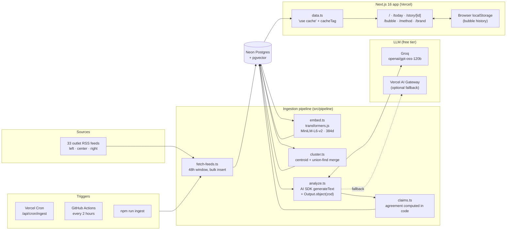

### Request flow

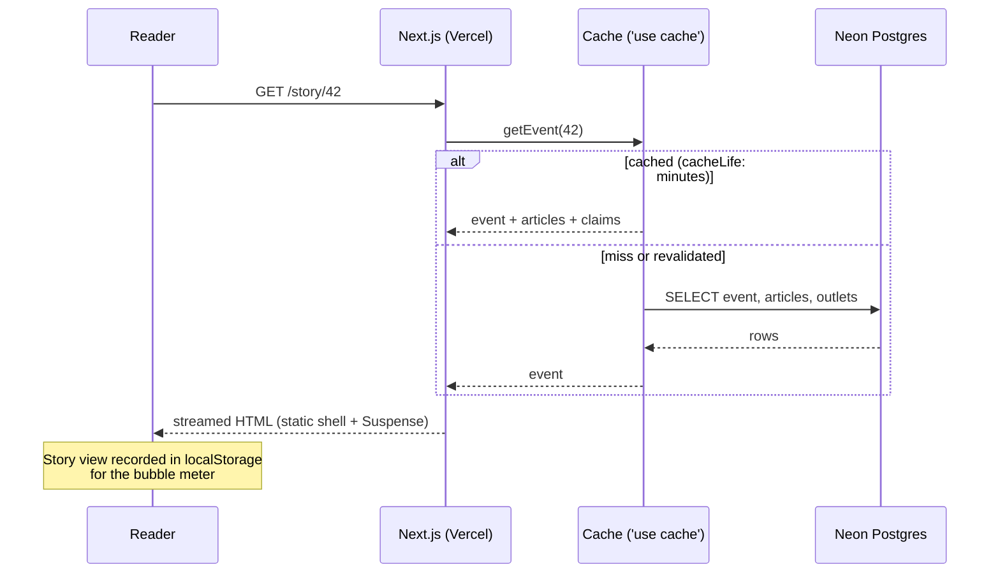

### Ingestion trigger and caching

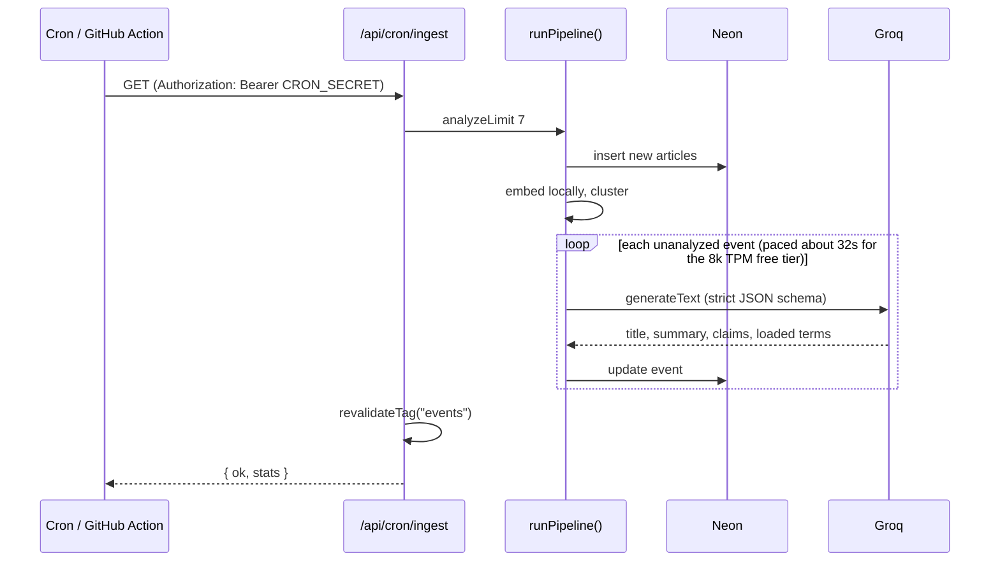

---

## Tech stack

| Layer | Choice | Why |
|---|---|---|
| Framework | **Next.js 16** (App Router, Cache Components, partial prefetching) | Static shells with streamed dynamic data; `'use cache'` and tags for cheap reads |
| UI | **React 19**, **Tailwind CSS 4** (CSS-first `@theme`), lucide-react | Design tokens as CSS variables, with light and dark mode |
| Charts | **D3** (`d3-scale`, `d3-force`) | Spectrum plot with collision-free outlet plates |
| Database | **Neon Postgres** + **pgvector** via `@neondatabase/serverless` | Serverless HTTP queries; vectors stored next to articles |
| Embeddings | **transformers.js** `Xenova/all-MiniLM-L6-v2` (q8) | Runs locally or in a function: free, private and fast |
| LLM | **AI SDK 7** + **Groq** (`openai/gpt-oss-120b`) | Free tier with no card; strict structured output. Vercel AI Gateway works as an alternative |
| Validation | **Zod 4** | Schema for the model's structured output |
| Feeds | **rss-parser** | Robust RSS/Atom parsing |
| Wording diff | **diff** + custom tokenizer | Distinctive-word highlighting across headlines |
| Scheduling | **Vercel Cron** and **GitHub Actions** | Daily on Vercel Hobby, every 2 hours on Actions, both free |
| Fonts | **Source Serif 4** (headlines), **Archivo** variable width (UI, wordmark) | Editorial newspaper typography |
| Video | **Hyperframes** + GSAP + Kokoro TTS | Product video rendered from HTML |
| Testing | Node test runner via `tsx --test`, ESLint, `tsc` | Fast unit tests for the core logic |

**Running cost: $0.** Neon free plan, a free Groq key (no card) and local embeddings.

---

## Project structure

```
verso/
├── .github/workflows/
│   ├── ci.yml                  # typecheck, lint, unit tests on every push / PR
│   └── ingest.yml              # free scheduled ingestion every 2 hours
├── db/
│   └── schema.sql              # idempotent schema: outlets, articles (vector 384), events, ingest_runs
├── docs/
│   ├── media/                  # product video + poster
│   └── screenshots/            # images used in this README
├── scripts/
│   ├── migrate.ts              # npm run db:migrate
│   └── ingest.ts               # npm run ingest -- <max events to analyze>
├── src/
│   ├── app/
│   │   ├── page.tsx            # landing: headline game, wall demo, how it works
│   │   ├── today/page.tsx      # today's wall
│   │   ├── story/[id]/page.tsx # story: summary, spectrum, headlines, claims, loaded words
│   │   ├── bubble/page.tsx     # personal bubble meter
│   │   ├── method/page.tsx     # pipeline, limits, outlet ratings, feed status
│   │   ├── brand/page.tsx      # brand board
│   │   ├── api/cron/ingest/    # secured pipeline trigger (maxDuration 300)
│   │   ├── layout.tsx          # fonts, masthead, theme script, footer
│   │   ├── globals.css         # design tokens (light / dark), highlighter, motion
│   │   └── icon.svg            # favicon mark
│   ├── components/
│   │   ├── brand/              # Mark, Wordmark
│   │   ├── spectrum/           # SpectrumPlot (D3), CoverageStrip
│   │   ├── story/              # HeadlineWall, ClaimsLedger, LoadedLanguage, AllCoverage, chips
│   │   ├── bubble/             # BubbleMeter, BubbleChip, view recorder
│   │   ├── landing/            # HeadlineQuiz
│   │   └── masthead, nav-links, theme-toggle, time, site-footer, sample-notice
│   ├── lib/
│   │   ├── outlets.ts          # 33 outlets: feed URL, lean (−1..1), reliability (0..1)
│   │   ├── cluster-core.ts     # pure clustering (tested)
│   │   ├── claims.ts           # agreement classification (tested)
│   │   ├── wording.ts          # distinctive / shared word analysis (tested)
│   │   ├── spectrum.ts         # positions, colors, coverage skew
│   │   ├── bubble.ts           # localStorage history + balance score
│   │   ├── models.ts           # Groq / Gateway model + local embeddings
│   │   ├── data.ts             # cached data access ('use cache', cacheTag)
│   │   ├── landing.ts          # quiz rounds from live events
│   │   ├── sample.ts           # fictional sample edition
│   │   ├── db.ts, types.ts
│   │   └── core.test.ts
│   └── pipeline/
│       ├── fetch-feeds.ts      # RSS to articles
│       ├── embed.ts            # articles to vectors
│       ├── cluster.ts          # vectors to events
│       ├── analyze.ts          # events to summary, claims, loaded terms
│       └── run.ts              # orchestrator, logs to ingest_runs
├── brag-output/                # product video source (Hyperframes composition)
├── PRODUCT.md                  # product principles and decisions
├── DESIGN.md                   # design tokens, type, components, motion
├── vercel.json                 # region, function limits, cron, headers
└── next.config.ts
```

---

## Getting started

### Prerequisites

- **Node.js 22+** (AI SDK 7 requires it)
- A free **[Neon](https://neon.tech)** Postgres database
- A free **[Groq](https://console.groq.com)** API key (no card needed)

### 1. Install

```bash
git clone https://github.com/Hamzaviour/Verso-AI.git
cd Verso-AI
npm install
```

### 2. Configure

```bash
cp .env.example .env.local
# fill in DATABASE_URL, GROQ_API_KEY and a random CRON_SECRET
```

### 3. Create the schema

```bash
npm run db:migrate        # enables pgvector and creates the tables
```

### 4. Pull in the news

```bash
npm run ingest            # fetch, embed, cluster, analyze up to 10 events
npm run ingest -- 20      # analyze up to 20 events
```

> On Groq's free tier (8,000 tokens per minute), analysis calls are paced about 32 seconds apart, so 10 events take roughly 5 minutes. The first run also downloads the 23 MB embedding model once.

### 5. Run

```bash
npm run dev               # http://localhost:3000
# or
npm run build && npm start
```

Without a database, or before any event has been analyzed, the site shows a labelled **sample edition**.

---

## Environment variables

| Variable | Required | Description |
|---|---|---|
| `DATABASE_URL` | ✅ | Neon Postgres connection string (`?sslmode=require`). |
| `GROQ_API_KEY` | ✅ * | Free Groq key used for analysis. *Leave empty to use Vercel AI Gateway instead.* |
| `CRON_SECRET` | ✅ on Vercel | Random string. Vercel Cron sends it as `Authorization: Bearer …`, and the route rejects anything else. |
| `VERSO_ANALYSIS_MODEL` | | Analysis model. Default `openai/gpt-oss-120b` on Groq. |
| `VERSO_EMBEDDING_MODEL` | | Embedding model. Default `Xenova/all-MiniLM-L6-v2` (384 dimensions; the schema expects 384). |
| `AI_GATEWAY_API_KEY` | | Only when using Vercel AI Gateway instead of Groq. |

Never commit `.env.local`. It is gitignored. Generate a cron secret with:

```bash
node -e "console.log(require('crypto').randomBytes(32).toString('hex'))"
```

---

## Deploying to Vercel

### One click

Use the **Deploy with Vercel** button at the top. It clones the repo and asks for `DATABASE_URL`, `GROQ_API_KEY` and `CRON_SECRET`.

### Manually

1. Push this repo to GitHub.
2. In Vercel, go to **Add New → Project** and import the repo. The framework is detected as Next.js.
3. Add the environment variables above for **Production** (and Preview if you want).
4. Deploy. `DATABASE_URL` must be set at build time, because pages prerender from the database.
5. Run `npm run db:migrate` and `npm run ingest` once from your machine to fill the database, if you haven't already.

Or with the CLI:

```bash
npm i -g vercel
vercel link
vercel env add DATABASE_URL
vercel env add GROQ_API_KEY
vercel env add CRON_SECRET
vercel --prod
```

### What `vercel.json` configures

```jsonc
{
  "framework": "nextjs",
  "regions": ["pdx1"],                       // next to Neon us-west-2 for low query latency
  "functions": {
    "src/app/api/cron/ingest/route.ts": {    // the pipeline needs time and memory
      "maxDuration": 300, "memory": 2048
    }
  },
  "crons": [{ "path": "/api/cron/ingest", "schedule": "0 12 * * *" }],  // daily (Hobby limit)
  "headers": [ /* nosniff, referrer policy, frame options */ ]
}
```

- **Region:** change `pdx1` if your Neon database is in a different region (for example `iad1` for `us-east-1`).
- **Cron frequency:** the Hobby plan allows one cron run per day. For fresher news at no cost, enable the included **GitHub Action** (`.github/workflows/ingest.yml`). It runs the whole pipeline every 2 hours on GitHub's runners. Add `DATABASE_URL` and `GROQ_API_KEY` as repository secrets. On a Pro plan you can set the Vercel cron to `0 */2 * * *` instead.
- **Embeddings on Vercel:** the model is cached in `/tmp` inside the function (`src/lib/models.ts`). `@huggingface/transformers` and `onnxruntime-node` are kept out of the bundle with `serverExternalPackages`.
- **`.vercelignore`** keeps the video source, docs and brief out of the deployment upload.

Trigger the pipeline by hand after deploying:

```bash
curl -H "Authorization: Bearer $CRON_SECRET" https://<your-app>.vercel.app/api/cron/ingest
```

---

## Scripts

| Command | Description |
|---|---|
| `npm run dev` | Start the dev server |
| `npm run build` | Production build |
| `npm start` | Serve the production build |
| `npm run db:migrate` | Apply `db/schema.sql` (safe to re-run) |
| `npm run ingest -- [n]` | Run the pipeline locally and analyze up to `n` events (default 10) |
| `npm run typecheck` | `tsc --noEmit` (run `npx next typegen` first on a fresh clone) |
| `npm run lint` | ESLint |
| `npm test` | Unit tests for clustering, claim classification and wording diff |

---

## Data model

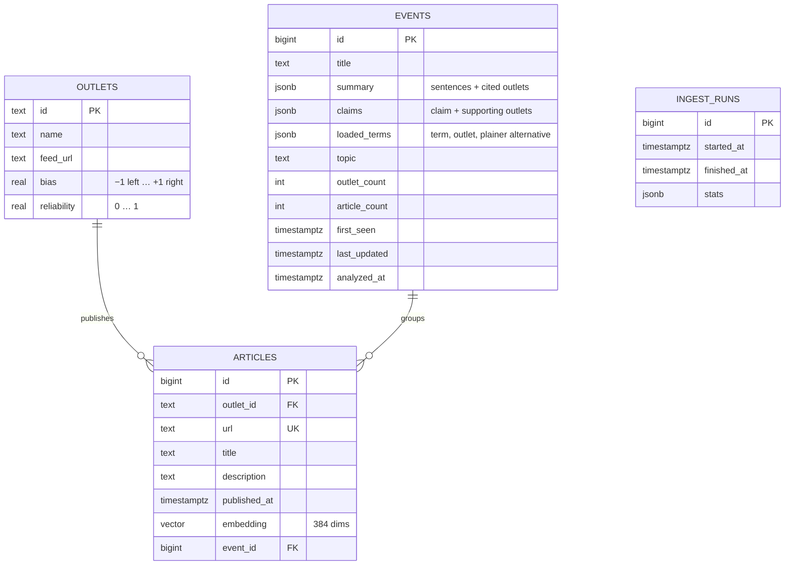

---

## Design system

Verso borrows from the print shop. The brand mark is two misregistered plates, cyan and magenta, whose overlap prints solid ink: two sides, one shared core.

| Token | Color | Meaning |
|---|---|---|
| Cyan | `#0086c3` | Left of center |
| Key / ink | `#131314` | Center, and the type |
| Magenta | `#c8006a` | Right of center |
| Process yellow | `#ffe14a` | Highlighter for distinctive words |
| Newsprint | `#e6e6e1` / sheet `#f3f3ef` | Page and cards |

- **Type:** Source Serif 4 for headlines and reading text; Archivo with a variable width axis for UI. The wordmark is set at 112% width, weight 800.
- **Signature details:** the cyan / key / magenta registration rule under the masthead, double-ruled small-caps front-page mastheads, outlets as typographic plates (no logos).
- **Motion:** plates slide from center to their positions, and highlighter strokes wipe in. All motion respects `prefers-reduced-motion`.

See [`DESIGN.md`](DESIGN.md) for the full token table and component rules, and [`PRODUCT.md`](PRODUCT.md) for product principles.

---

## Testing and quality

```bash
npm test            # 6 unit tests: clustering, claim classification, wording diff
npm run typecheck
npm run lint
```

CI runs all three on every push and pull request (`.github/workflows/ci.yml`).

---

## Honesty and limits

- **Ratings are estimates.** Outlet lean and reliability (`src/lib/outlets.ts`) are editorial estimates informed by public media-bias ratings. They are labelled as such on `/method`.
- **Headlines and descriptions only.** RSS gives headlines and short descriptions, so claims are extracted from those, not from full articles.
- **The model attributes, code judges.** The LLM only says which outlets report a claim. Whether that claim counts as agreed or one-sided is decided by deterministic code.
- **Clustering is imperfect.** Two events on a similar topic can occasionally merge. The thresholds are tuned on measured data, not guessed.
- **Some feeds block bots.** A few outlets' feeds return 403 or time out. Their status is shown live on `/method`.
- **No logos.** Outlets appear as typographic marks. No trademarks are reproduced.
- **Privacy.** Reading history for the bubble meter lives only in your browser's `localStorage`.

---

## Roadmap

- [ ] Replace blocked feeds with working alternatives
- [ ] Full-text extraction for richer claims (where licensing allows)
- [ ] Per-topic pages and search over pgvector
- [ ] Outlet profile pages with framing history
- [ ] Email digest of the day's most contested story
- [ ] Vertical and 20-second cuts of the product video

---

## Credits

- Original brief: *Spectrum*, see [`12-spectrum.pdf`](12-spectrum.pdf).
- Embeddings: [sentence-transformers/all-MiniLM-L6-v2](https://huggingface.co/sentence-transformers/all-MiniLM-L6-v2) via [transformers.js](https://huggingface.co/docs/transformers.js).
- Analysis: [Groq](https://groq.com) running `openai/gpt-oss-120b`, through the [AI SDK](https://ai-sdk.dev).
- Database: [Neon](https://neon.tech) with [pgvector](https://github.com/pgvector/pgvector).
- Fonts: [Source Serif 4](https://fonts.google.com/specimen/Source+Serif+4) and [Archivo](https://fonts.google.com/specimen/Archivo) (SIL Open Font License).
- Video: Hyperframes, GSAP, Kokoro TTS.
- Headlines and descriptions belong to their respective publishers. Verso links to every original article.

<div align="center">

<br />


**Read the other side.**

</div>
